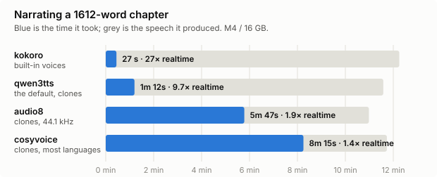

# dream-tts

Narrate anything in a cloned voice, on your own Mac, offline. A 1612-word chapter becomes
11 minutes of speech in about 1m 15s — or 12 minutes in 27 seconds, if a built-in voice will do.
One binary, no service, no API key, no Python at runtime.

### ▶ [Hear it first: one chapter, four engines, two voices each](https://drmhse.github.io/dream-tts/)



**Requirements: macOS 13 or newer on Apple silicon, and `curl`.** The custom kernels are Metal,
and every number here was measured on an M4 with 16 GB. It also builds and runs on Linux and on
the CPU with `--no-default-features`, much more slowly.

## Speak your first sentence

```sh
curl -fsSL https://raw.githubusercontent.com/drmhse/dream-tts/main/install.sh | sh
cd dream-tts && ./scripts/bootstrap.sh       # the model. ~4.3 GB, resumable, verified

./dream-tts speak --text "Hello from a fresh install." --out hello.wav
```

No Rust toolchain and no Python: a `v*` tag publishes prebuilt arm64 binaries, and the default
engine, `qwen3tts`, needs no conversion step. From a git clone with a toolchain,
`./scripts/bootstrap.sh` builds instead. The other engines are one command each:

```sh
./scripts/bootstrap.sh --list              # the ids, their models, what each costs
./scripts/bootstrap.sh kokoro              # 0.7 GB, and the fastest engine here
./scripts/bootstrap.sh audio8 cosyvoice    # 44.1 kHz output, and the widest language coverage
```

Converting those checkpoints is where Python appears, once, in a venv; only the engines you
ask for pay it. [Setup](docs/reference.md#setup) has the details.

## Speak in someone's voice

A voice is a directory, and the repo ships several. Your own takes a clip of about ten seconds
and its exact transcript:

```sh
references/qwen3tts/.venv/bin/python references/qwen3tts/export_voice.py \
    --model references/qwen3tts/weights --audio clip.wav \
    --text "the exact words spoken in the clip" \
    --name my-voice --out voices/my-voice

./dream-tts speak --voice voices/my-voice --text-file chapter.md --out chapter.wav
```

`kokoro` cannot clone; it carries 28 voices and takes one by name:
`--engine kokoro --set voice=am_michael`.

## The engines

The same 1612-word chapter (`examples/chapter.txt`), each engine as it ships, two voices each.

| engine | RTF | wall time | peak memory | reach for it when |
|---|---|---|---|---|
| `qwen3tts` | **0.104–0.114** | **1m 12s–1m 19s** | 9.2 GB | the default. Best quality here, and the cloning engine that makes a book practical |
| `kokoro` | **0.034–0.036** | **27 s** | 2.0 GB | English, no cloning, and you want it now — or have 2 GB to spare rather than 9 |
| `audio8` | 0.527–0.536 | 5m 47s | 9.7 GB | you want 44.1 kHz, the highest-fidelity output here |
| `cosyvoice` | 0.703–0.718 | 8m 15s | 5.0 GB | you want the widest language coverage |

A 16-hour book costs about **1.7 hours** of compute on the default rather than 11.5. Compare
wall time, not only RTF: the engines speak at different speeds, and RTF flatters the slow ones.
`qwen3tts` batches across segments, so it wants length — 0.314 on a 132-word passage — while
the others are steady at any length. `audio8`'s and `cosyvoice`'s memory figures are for that
short passage.

**Why it is fast.** `qwen3tts` runs 48 lanes batched across a document's segments, sorted
longest first and shedding each finished tail, on f16 weights through GEMMs written for a decode
step's shape; the codec's convolutions gather their taps inside the GEMM, and its activations
fold into the convs. `kokoro` has no token loop at all: one pass predicts every phoneme's
duration, and its decoder runs as one MPSGraph per block. Each of those, the measurement that
justified it, and the eleven paths that lost, are in [Performance](docs/reference.md#performance)
and [What did not work](docs/reference.md#what-did-not-work).

## Narrate a book, from any document

```sh
dream-tts book book.epub --out narration      # start, watch, Ctrl-C is safe
dream-tts jobs                                 # what is running, anywhere on this machine
dream-tts jobs <id> --control pause --now      # stop within seconds
dream-tts book book.epub --out narration      # the same command resumes it
```

A run belongs to `dream-tts-serve`, so it survives the terminal; its record is a file, so any
process can find it; and its id is a hash of the text and settings, so resuming is the same
command. Progress arrives per segment, and the time remaining is fitted to the chapters already
done rather than averaged. [Runs, and watching them](docs/reference.md#runs-and-watching-them)
explains each choice.

`dream-tts import` splits a document into chapters, and `speak --text-file` reads the same
formats: EPUB, DOCX, ODT, HTML, Markdown, PDF (through PDFKit), RTF, FictionBook, web pages,
and images or scanned pages through Vision OCR, with Calibre, LibreOffice or Pandoc taking
the rest when installed. Markdown is rewritten for the ear first — code, LaTeX, units, tables
and about forty other rules — so a voice never reads its syntax aloud.
`scripts/narrate-book.sh` adds WebM delivery files and word alignment, with `ffmpeg`.

## Serve it over HTTP

```sh
DREAM_TTS_API_KEY=secret ./dream-tts-serve --port 3003

curl -X POST localhost:3003/tts -H "X-API-Key: secret" \
     -H 'content-type: application/json' \
     -d '{"text":"Hello from Rust.","voice":"voices/cosy-default-male","seed":7}' \
     -o out.wav
```

| route | |
|---|---|
| `POST /tts` | a WAV; `voice`, `speaker` and `seed` per request. Headers carry the RTF and each stage's time |
| `POST /tts/stream` | raw PCM as each segment lands: first audio in 2.7 s against 5.5 buffered |
| `POST /v1/batch` | up to 16 texts in one engine run, each with its own WAV, word clock and segment clock |
| `GET /v1/capabilities` | engines, voices, languages, sample rates |
| `GET /v1/jobs`, `/v1/jobs/<id>/events` | narration runs, and their live progress as server-sent events |
| `GET /` | every route, as JSON to a client and **as a page to a browser** |

## Use it as a library

```rust
use tts_core::{EngineConfig, SynthesisRequest, Voice};

let id = tts_engines::default_id();                   // "qwen3tts"
let engine = tts_engines::load(id, &EngineConfig::new(tts_engines::default_root(id)))?;
let request = SynthesisRequest::new("Hello from Rust.")
    .with_voice(Voice::load(tts_engines::default_voice(id))?);
let out = engine.synthesize(&request)?;
tts_core::wav::write("hello.wav", &out.audio)?;
```

`tts_serve::Local` gives a host the server's synthesis without the server: one engine in your
own process, single texts or batches. DreamReader runs Kokoro this way on the iPhone.

## Day to day

```sh
./dream-tts config       # every setting, and which file or variable decided it
./dream-tts storage      # what is on disk, biggest first, and what removes each part
./dream-tts engines      # what is installed, and what each supports
./scripts/uninstall.sh   # reports; deletes nothing until you name a category
```

Settings live in `dream-tts.json` (copy [`dream-tts.example.json`](dream-tts.example.json)),
and `data_dir` can put the 4–13 GB of weights on another disk. Two large engines do not fit in
16 GB at once, so synthesis holds a lock and a second one is refused by name rather than left
to swap. [Settings and storage](docs/reference.md#settings-and-storage) covers the rest.

## Limitations

- **`qwen3tts` speaks ten languages**: en, de, es, zh, ja, fr, ko, ru, it, pt. Outside them it
  warns, and `--engine audio8` or `cosyvoice` is the path.
- **`kokoro` speaks English and cannot clone.** Its frontend has no espeak-ng, which is GPL;
  a word outside its lexicon is derived by rule or, in American English, guessed by g2p_en's
  small Apache-2.0 model, so an unusual word may come out a near miss. British voices name such
  words instead of saying them. [Out-of-lexicon words](docs/kokoro-frontend.md#out-of-lexicon-words)
  has the measurements.
- **`audio8`'s codec and `cosyvoice`'s vocoder** are about a third slower than when first
  measured, and the cause is not yet found.
- **Sampled output matches PyTorch in distribution, not sample for sample.** Pass a `seed` to
  repeat a render here.

## How it is built

Four PyTorch models ported to Rust and candle, with the Metal kernels written here. Every stage
is checked against fp32 activations dumped from its reference, so a mismatch names the layer
that caused it, and `./scripts/gates.sh` runs those checks from ~130 MB of published ground
truth with no PyTorch installed.

Everything else is in **[docs/reference.md](docs/reference.md)**: setup, architecture,
validation, performance, the porting traps, serving, documents, runs, and what did not work.
Agents get [`AGENTS.md`](AGENTS.md) and the [`dream-tts` skill](.agents/skills/dream-tts/SKILL.md).

```
crates/tts-core/        the Engine trait, voice assets, segmentation, WAV
crates/tts-nn/          shared model machinery and the Metal kernels
crates/tts-engines/     the registry: the one place that knows which engines exist
crates/tts-cli/         dream-tts            crates/tts-serve/   dream-tts-serve, and Local
crates/tts-narrate/     text for the ear     crates/tts-import/  any document, chapters, web pages
crates/tts-phoneme/     Kokoro's English frontend
crates/{audio8,cosyvoice,qwen3tts,kokoro}/   one engine each, with its fixture gate
references/             the PyTorch side: conversion, fixtures, quality
voices/  examples/  scripts/  docs/
```
